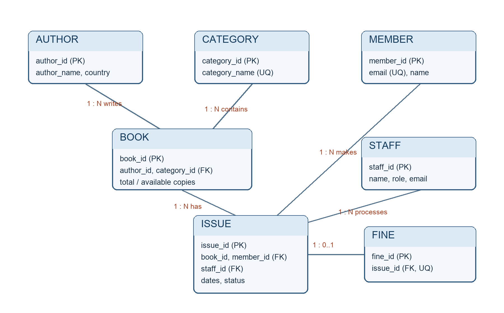

# Library Management System — Review III Report

## Evaluation coverage

This report follows the supplied **REVIEW III – Integrated System & Final Demonstration** rubric. The five operations in Section 7 are database writes; the cursor and reports are shown separately.

| Evaluation component | Evaluation criteria | Marks | Evidence |
|---|---|---:|---|
| Integrated Database Operation | Database components work together to support the proposed application | 2 | Sections 2–4: seven related tables, constraints, API-to-Oracle flow |
| Real-World Transactions | Demonstration of at least 5 meaningful transactions / operations | 3 | Section 7: register member, add book, issue book, return overdue book, mark fine paid |
| SQL/PLSQL Interaction | Appropriate use of queries, procedures, functions, cursors and triggers during transactions | 2 | Sections 5–7: object call chain, SQL verification and cursor execution |
| Output & Reports | Correct and meaningful results / reports generated from the database | 1 | Sections 5, 8 and live verification appendix: dashboard, overdue/fine reports and 15 query outputs |
| Project Report & Documentation | Completeness, clarity and technical documentation | 1 | ER diagram, schema, operation evidence, testing, demo order and source files |

**Student:** Suyash Singh\
**Register number:** 24BYB0078\
**Course:** BCSE302L / BCSE302P Database Systems Lab\
**Slot / faculty:** G1 / Ramkumar T\
**Institution:** Vellore Institute of Technology\
**Project type:** Individual project

## 1. Introduction and problem statement

A library must know which books and copies it owns, who has borrowed them, when they are due, and which late fees remain unpaid. Manual registers can duplicate members, issue unavailable books, miss overdue returns, and miscalculate fines. This project keeps those records in a relational Oracle database and connects them to an interactive librarian dashboard.

Review I defined the entities, relationships, and functional requirements. Review II created the tables, constraints, sample data, 15 queries, two procedures, two functions, an explicit cursor demonstration, and two triggers. Review III connects that database to a Flask API and browser interface. The browser interface extends the original Review I scope for the final integrated demonstration.

## 2. Functional requirements and completed system

| Requirement | Implementation |
|---|---|
| Store books, authors, categories, members and staff | CRUD pages and Oracle tables `BOOK`, `AUTHOR`, `CATEGORY`, `MEMBER`, `STAFF` |
| Issue only available books | `issue_book` inserts an `ISSUE`; `trg_issue_insert` checks and decrements copies |
| Record due dates and returns | `ISSUE` dates/status; `return_book` procedure |
| Restore stock on return | `trg_issue_return` increments available copies on `Issued` to `Returned` |
| Calculate and track fines | `overdue_days`, `calculate_fine`, `FINE` table, payment-status update |
| Show activity and reports | Dashboard, issue history, overdue cursor page, 12 SQL-backed reports and CSV export |
| Demonstrate INSERT, UPDATE and DELETE | Member/book/author/category forms, fine payment, and deletion with FK protection |

The application is a local librarian/admin demonstration. It has no member login, online payment, reservation or e-book feature.

## 3. ER diagram and relational schema



`ISSUE` resolves the many-to-many relationship between books and members over time. `FINE.issue_id` is both a foreign key and unique, so an issue has at most one fine.

Relational schema:

```text
AUTHOR(author_id PK, author_name, country)
CATEGORY(category_id PK, category_name UNIQUE)
BOOK(book_id PK, title, author_id FK→AUTHOR, category_id FK→CATEGORY,
     price, total_copies, available_copies)
MEMBER(member_id PK, name, email UNIQUE, phone, join_date, membership_type)
STAFF(staff_id PK, name, role, email UNIQUE)
ISSUE(issue_id PK, book_id FK→BOOK, member_id FK→MEMBER, staff_id FK→STAFF,
      issue_date, due_date, return_date, status)
FINE(fine_id PK, issue_id UNIQUE FK→ISSUE, amount, paid_status)
```

The exact Oracle DDL and constraints are in [`sql/schema.sql`](../sql/schema.sql). They include primary and foreign keys, `NOT NULL`, `UNIQUE`, `CHECK`, and `DEFAULT`. The sample data in [`sql/sample_data.sql`](../sql/sample_data.sql) has at least ten rows in every table: 10 authors, 10 categories, 10 books, 10 members, 10 staff, 15 issues, and 10 fines.

### Purpose of every table

| Table | Purpose and important columns | Relationship and integrity rule |
|---|---|---|
| `AUTHOR` | Writer identity: `author_id` PK, required `author_name`, `country` (default India). | One author can have many `BOOK` rows. |
| `CATEGORY` | Catalog grouping: `category_id` PK, unique required `category_name`. | One category can contain many books, including none. |
| `BOOK` | Title, price and inventory: `book_id` PK, `author_id`, `category_id`, positive `price`, `total_copies`, `available_copies`. | Author/category FKs; `0 ≤ available_copies ≤ total_copies`; one book can have many issues. |
| `MEMBER` | Borrower: `member_id` PK, required name and unique email, phone, join date (default today), membership type. | One member can have many issues; type is Student, Faculty or General. |
| `STAFF` | Librarian: `staff_id` PK, required name/role and unique email. | One staff member can handle many issues; staff activity is reportable. |
| `ISSUE` | Borrowing history: `issue_id` PK, book/member/staff FKs, issue/due/return dates, status. | Connects borrowers and books over time; status is Issued or Returned; triggers maintain stock. |
| `FINE` | Late fee: `fine_id` PK, unique `issue_id` FK, positive amount and payment status. | Optional child of ISSUE; at most one fine per issue; status is Paid or Unpaid. |

`ISSUE` is the central transaction table. A new issue references an existing book and member; an overdue return can create one fine. Oracle rejects missing foreign-key parents, duplicate member emails, invalid status values and invalid stock counts. The application also validates user input before a write.

## 4. Database implementation and connectivity

```text
Browser (HTML/CSS/JavaScript)
  → fetch /api/* JSON
Flask routes (validation, transactions, serialization)
  → python-oracledb connection pool
Oracle tables + SQL queries + PL/SQL procedures/functions/triggers
  → JSON results and dashboard/report output
```

The connection parameters are read from `.env` by [`db.py`](../db.py). Flask routes in [`app.py`](../app.py) use bound SQL parameters. Writes commit after dependent database work succeeds and roll back on Oracle errors. The issue and return routes call the Review II procedures; the application never manually adjusts stock for those operations.

For a fresh database, run `sql/schema.sql`, then `sql/sample_data.sql`, then `sql/procedures.sql`. The sample inserts historical issues directly, so the triggers are installed **after** the sample data to avoid changing its prepared copy counts. Existing Review II databases should be verified instead of recreated. Run `python scripts/verify_oracle.py` after configuring credentials. A passing `/api/status` must show `connected: true` for the final Oracle demonstration. Demo mode uses static data and does not prove database integration.

## 5. SQL queries and outputs

The 15 Review II SQL queries are in [`sql/queries.sql`](../sql/queries.sql). They cover joins, availability filtering, history, grouping, `LEFT JOIN`, `NOT EXISTS`, subqueries, `HAVING`, overdue dates, fine totals, and staff activity. The integrated Reports page offers 12 related live queries through `/api/reports/<name>`.

The following results were observed from the local Oracle `LIBRARY` schema on 26 October 2026. Full row-by-row output for all 15 queries is in the [live verification appendix](live-verification.md), which is also included in the PDF report.

| Query / report | Observed result |
|---|---|
| Dashboard titles / copies / available | 10 titles, 43 total copies, 38 available copies |
| Active and overdue issues | 5 active issues, IDs 11–15; all 5 are overdue |
| Fine summary | Paid: ₹55 from 4 fines; Unpaid: ₹110 from 6 fines |
| Books by category | Fiction: 3; Classic: 2; Fantasy, Biography, History, Science, Mystery: 1 each; Self-Help, Technology, Education: 0 |
| Staff activity | Staff IDs 1–5 handled 2 issues each; IDs 6–10 handled 1 each |
| Borrow count per member | Members 2–6 have 2 issues each; members 1 and 7–10 have 1 each |
| Inactive members | None in the sample |

The appendix also records actual INSERT, UPDATE, DELETE, issue, return, fine and cursor results from reversible Oracle transactions. A separate reversible catalog insert confirmed the fifth write operation. Those verification transactions were rolled back, leaving the sample data unchanged. The live result can change with the Oracle server date and later UI transactions. The CSV button exports the rows currently returned by each report endpoint.

| Report to show live | What it demonstrates | Expected change during the five operations |
|---|---|---|
| Available Books | SQL filter on positive `available_copies` | Added two-copy book appears; issuing it leaves one available. |
| Issue History | Joins ISSUE, MEMBER, BOOK and STAFF | New issue shows the selected borrower, title and staff member. |
| Overdue Issues | Joined date/status filter | Returned overdue issue disappears. |
| Fine Management and summary | Joins and `GROUP BY paid_status` | New fine appears Unpaid, then moves to Paid. |
| Books by Category | `LEFT JOIN` and `GROUP BY` | Added title increases its category's count; empty categories remain visible. |
| Staff Activity | `LEFT JOIN` and `COUNT` | The issuing staff member's handled count rises. |

## 6. Procedures, functions, cursor and triggers

All Review II PL/SQL definitions are in [`sql/procedures.sql`](../sql/procedures.sql).

| Object | Role in an integrated operation |
|---|---|
| `issue_book` procedure | Inserts a new borrowing transaction |
| `return_book` procedure | Locks the issue, records the return and inserts a positive fine |
| `overdue_days` function | Calculates nonnegative late calendar days |
| `calculate_fine` function | Multiplies late days by ₹5 |
| `trg_issue_insert` | Rejects unavailable books and decrements stock after issue insert |
| `trg_issue_return` | Restores one copy when status changes from `Issued` to `Returned` |
| `overdue_cursor` | Review II explicit cursor prints each overdue issue in SQL Developer |

The Database Logic page runs the same overdue selection through a PL/SQL `SYS_REFCURSOR` and fetches its rows into the UI. This is an actual cursor invocation; the Review II block remains available for a SQL Developer demonstration.

## 7. Five real-world database operations

These five **write operations** form a coherent librarian workflow: register a borrower, add a catalog title, issue a copy, return an overdue copy, and settle the resulting fine. Record generated IDs during the live run because `MAX(id)+1` can differ from the sample. The evidence below came from reversible Oracle transactions; those test writes were rolled back. Actions in the website commit and remain in the database.

### Operation 1 — Register a member (`MEMBER` INSERT)

**User action:** Members → Register Member. Enter a unique name/email, phone and membership type. Example: `Review III Student`, `review3.student@example.com`, `9876543210`, Student.

**Database action:** Flask validates the form and inserts `MEMBER`. Oracle applies `join_date DEFAULT SYSDATE`, the unique email rule and the membership-type check.

```sql
INSERT INTO MEMBER (member_id, name, email, phone, membership_type)
VALUES (:member_id, :name, :email, :phone, :membership_type);
SELECT member_id, name, email, membership_type, join_date
FROM MEMBER WHERE email = :email;
```

**UI result:** The member appears in Members and becomes selectable in Issue Book. **Observed Oracle evidence:** the reversible test displayed new MEMBER 11 (`Review 3 Test Member`, Student); rollback restored the original 10-member sample.

### Operation 2 — Add a catalog book (`BOOK` INSERT with author/category FKs)

**User action:** Books → Add Book. Choose an existing author and category; enter a unique title, price ₹250 and two copies.

**Database action:** Flask inserts the title with `available_copies = total_copies`. Oracle verifies the `AUTHOR` and `CATEGORY` foreign keys, positive price and valid copy counts.

```sql
INSERT INTO BOOK
  (book_id, title, author_id, category_id, price, total_copies, available_copies)
VALUES (:book_id, :title, :author_id, :category_id, :price, :copies, :copies);
SELECT b.book_id, b.title, a.author_name, c.category_name,
       b.total_copies, b.available_copies
FROM BOOK b JOIN AUTHOR a ON a.author_id = b.author_id
JOIN CATEGORY c ON c.category_id = b.category_id
WHERE b.book_id = :book_id;
```

**UI result:** The book appears in Books and Available Books; its category count rises. **Observed Oracle evidence (26 October 2026):** BOOK count 10 → 11; BOOK 11 `Review III Catalog Verification` had total 2 and available 2. Rollback restored count 10 and removed BOOK 11.

### Operation 3 — Issue a copy (`ISSUE` INSERT, procedure and stock trigger)

**User action:** Issue Book → choose the newly registered member, the added book, a staff member, and a due date today or later. Record the issue ID shown by the site.

**Database action:** Flask calls `issue_book`, which inserts `ISSUE`; `trg_issue_insert` rejects zero stock or decrements `BOOK.available_copies` once.

```sql
BEGIN issue_book(:issue_id, :book_id, :member_id, :staff_id, :due_date); END;
SELECT issue_id, book_id, member_id, staff_id, due_date, status
FROM ISSUE WHERE issue_id = :issue_id;
SELECT total_copies, available_copies FROM BOOK WHERE book_id = :book_id;
```

**UI result:** Issue History shows status Issued; the new book's available copies go 2 → 1. **Observed Oracle evidence:** the reversible test created ISSUE 16; BOOK 1 availability went 4 → 3 and returned to 4 after rollback. The issue row disappeared on rollback.

### Operation 4 — Return an overdue issue (`ISSUE` UPDATE, functions, trigger, `FINE` INSERT)

**User action:** Return Book → choose one existing overdue active issue (sample IDs 11–15 were overdue on 26 October 2026) → Return. The new issue from Operation 3 has a future due date, so use an older sample issue to show fine calculation immediately.

**Database action:** `return_book` locks and checks the issue, calls `calculate_fine` and `overdue_days`, updates status and return date, then inserts a positive Unpaid fine. `trg_issue_return` restores one copy. A repeat return is rejected.

```sql
BEGIN return_book(:issue_id); END;
SELECT i.issue_id, i.status, i.due_date, i.return_date,
       b.title, b.available_copies, f.amount, f.paid_status
FROM ISSUE i JOIN BOOK b ON b.book_id = i.book_id
LEFT JOIN FINE f ON f.issue_id = i.issue_id
WHERE i.issue_id = :issue_id;
```

**UI result:** Returned status, return date, one restored copy and an Unpaid fee of ₹5 per late calendar day. **Observed Oracle evidence:** a reversible test returned ISSUE 16 with a due date one day before server date; BOOK 1 copies went 3 → 4 and a ₹5 Unpaid fine appeared. Rollback restored the initial state. A live sample issue's fee depends on the day it is returned.

### Operation 5 — Mark the fine paid (`FINE` UPDATE and summary query)

**User action:** Fine Management → find the fine created in Operation 4 → Mark Paid. This records settlement status; no bank payment is processed.

**Database action:** The API updates `FINE.paid_status`. The fine summary groups amounts by Paid and Unpaid.

```sql
UPDATE FINE SET paid_status = 'Paid' WHERE fine_id = :fine_id;
SELECT fine_id, issue_id, amount, paid_status FROM FINE WHERE fine_id = :fine_id;
SELECT paid_status, COUNT(*) AS fine_count, SUM(amount) AS total_amount
FROM FINE GROUP BY paid_status;
```

**UI result:** The fine moves from Unpaid to Paid, and both totals change by the same amount. **Observed Oracle evidence:** sample FINE 1 temporarily became Paid in the reversible test; rollback left it Unpaid. During the live demo use the fine ID generated by Operation 4.

**Separate cursor and report demonstration:** Database Logic → Run Overdue Cursor Demo, then Reports → Overdue Issues → Export CSV. The PL/SQL reference cursor and joined report read `ISSUE`, `MEMBER` and `BOOK` where `status = 'Issued' AND TRUNC(due_date) < TRUNC(SYSDATE)`. The returned sample issue disappears from this result. The cursor and report are read operations, so they are shown in addition to the five writes.

**Additional DELETE integrity check:** a temporary unreferenced member was inserted and deleted in a reversible Oracle test. Referenced parent rows cannot be deleted because Oracle foreign keys protect their children. Do not delete an `ISSUE` directly during the demo: stock restoration depends on the return trigger.

## 8. Verification, limits and conclusion

Verification on 26 October 2026: `venv/bin/python -m unittest discover -s tests -v` ran 39 tests with two live tests skipped by default. `RUN_LIVE_ORACLE_TESTS=true venv/bin/python -m unittest tests.test_app.LiveOracleTests -v` passed both live tests. `venv/bin/python scripts/verify_oracle.py` confirmed all seven tables and six required stored objects. `/api/status` returned `connected: true` and `demo_mode: false` when the local site was checked. The [live verification appendix](live-verification.md) records outputs from all 15 queries and reversible transactions using real Oracle procedures, functions, cursor and triggers.

### Start-to-end presentation order

1. Start the existing Oracle container and site; on this machine the configured address is `http://127.0.0.1:5001`. Confirm **Oracle connected**. Do not recreate the prepared schema.
2. Explain the ER diagram and all seven tables using Section 3; identify primary keys, foreign keys and constraints.
3. Show the Dashboard baseline and state that its figures are SQL aggregations from Oracle.
4. Perform the five writes in Section 7, in order. Record IDs from the UI and show each changed row/copy count.
5. Run the Database Logic overdue cursor. Open Overdue Issues, Fine Management and Books by Category; export one CSV.
6. If asked for SQL, run the SELECT statements under each operation and open `sql/queries.sql` for all 15 Review II queries.

The companion [`docs/demo-checklist.md`](demo-checklist.md) provides a shorter UI rehearsal. The source files are `sql/schema.sql` (tables), `sql/sample_data.sql` (prepared rows), `sql/procedures.sql` (PL/SQL), `sql/queries.sql` (15 queries), `app.py` and `db.py` (integration), and `static/` (interface).

The system integrates the seven-table database with the Review II SQL and PL/SQL logic and presents five meaningful write operations plus live reports through the UI. The main limits are local-only use without authentication or a payment gateway, optional nonpersistent demo-mode writes, and `MAX(id)+1` ID allocation under concurrent requests. For the final viva, keep `DEMO_MODE=false`, open the website with Oracle connected and demonstrate the five operations.
