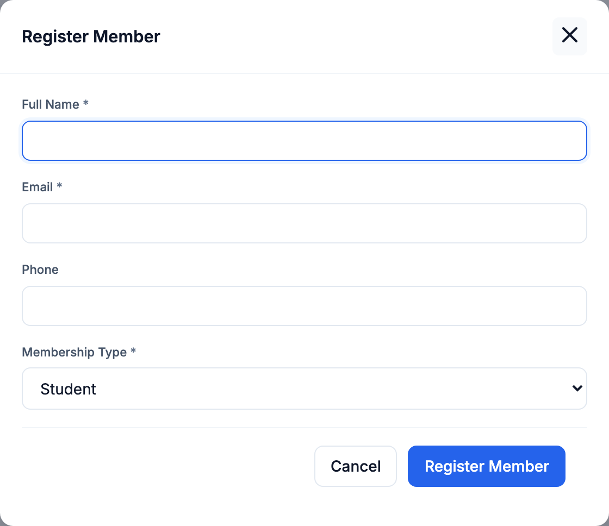
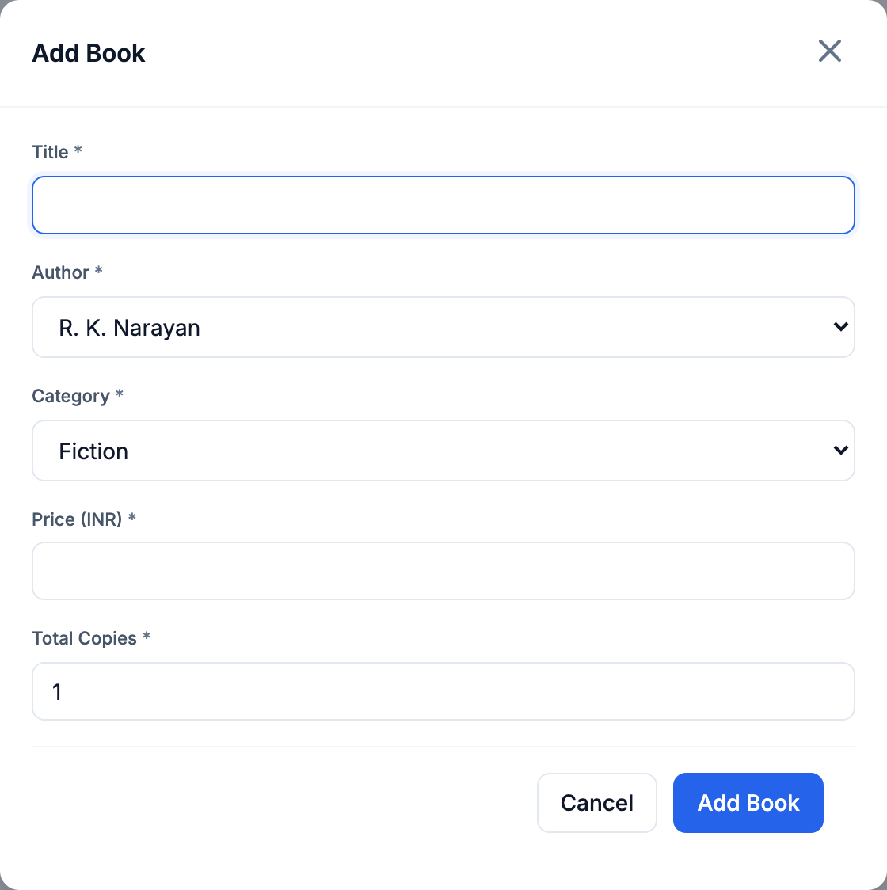
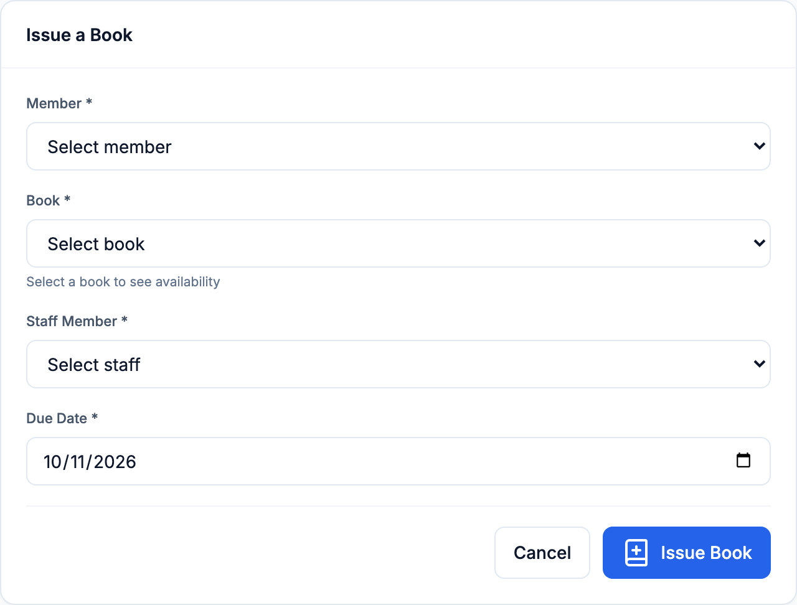
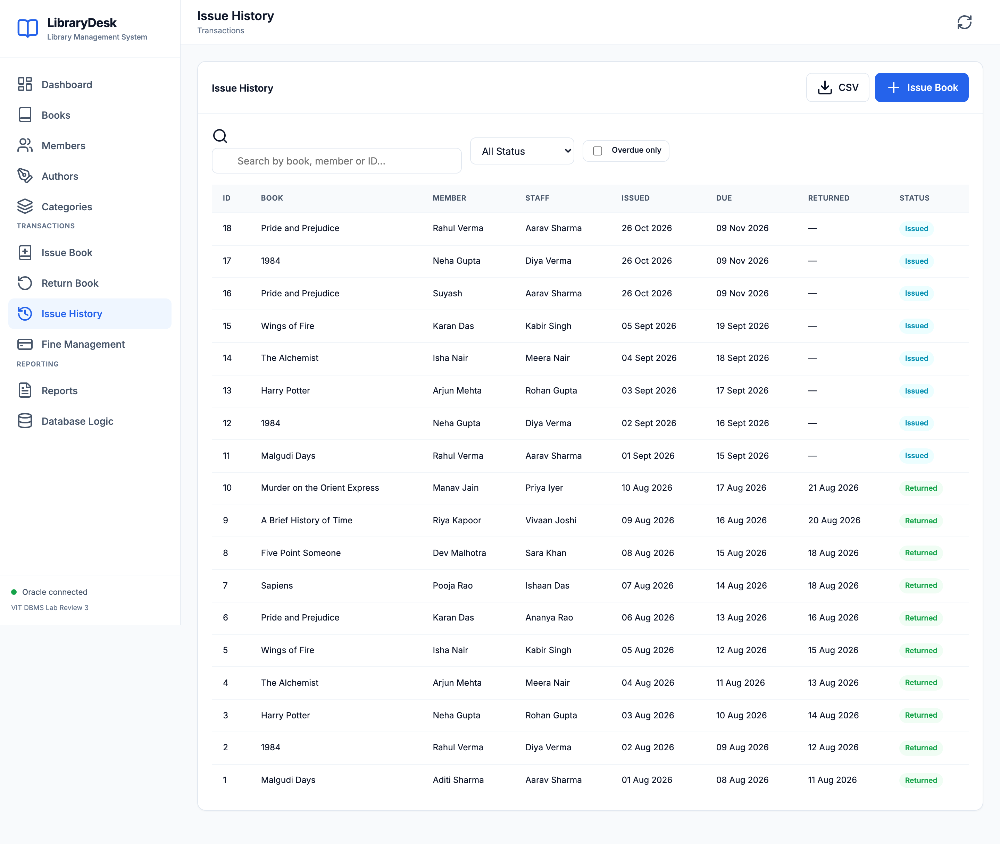
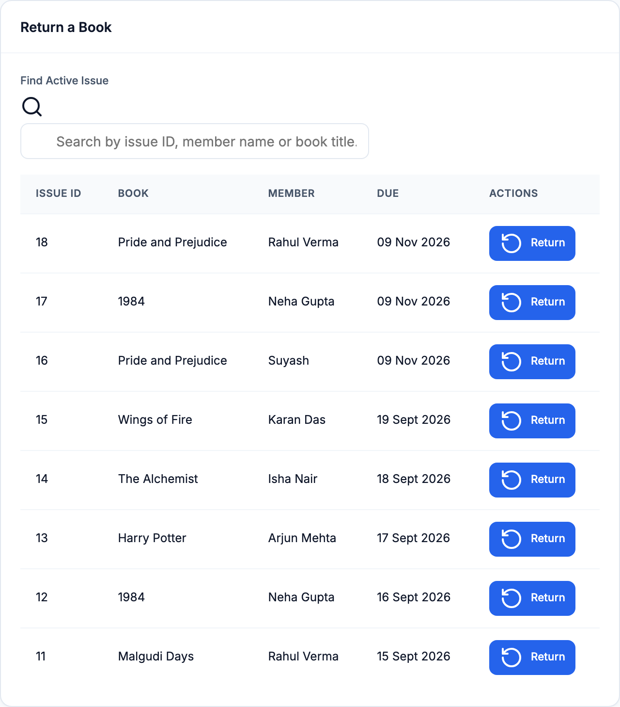
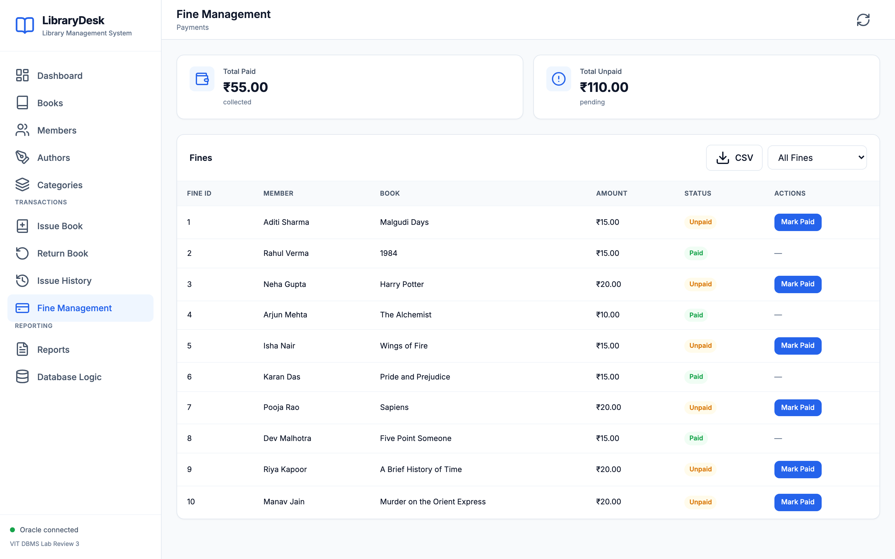
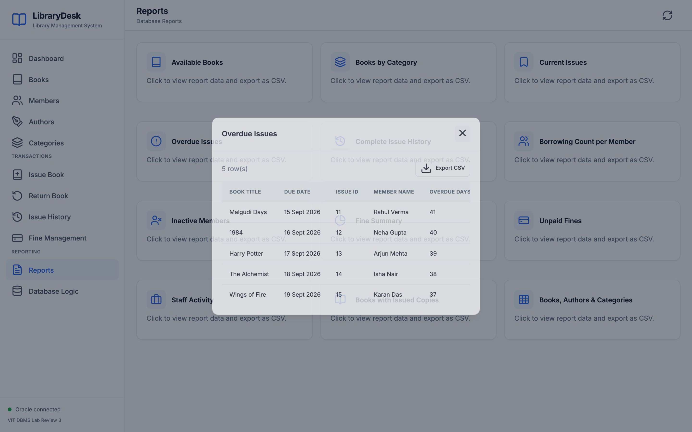
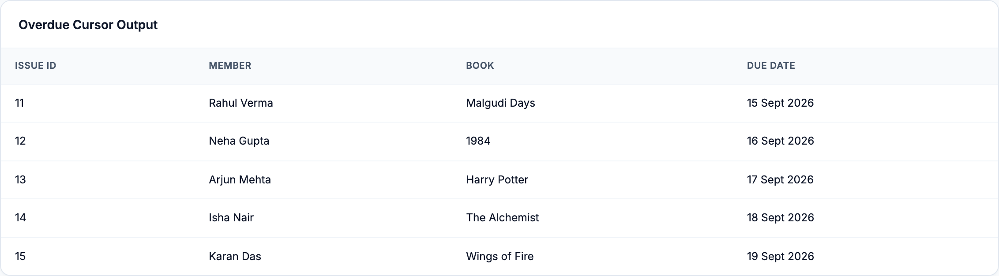

# REVIEW III — Integrated System & Final Demonstration

## Library Management System

**Student:** Suyash Singh  
**Register number:** 24BYB0078  
**Course:** BCSE302L / BCSE302P Database Systems Lab  
**Faculty / slot:** Ramkumar T / G1  
**Institution:** Vellore Institute of Technology

## 1. Review III requirements and evidence

| Evaluation component | What this submission shows |
|---|---|
| Integrated Database Operation (2 marks) | Browser → Flask API → Oracle; seven linked tables, constraints, stock triggers and fine creation. |
| Five Real-World Transactions (3 marks) | Register member, add book, issue book, return overdue book, mark fine paid. Each operation has an explanation and its own screenshot immediately below it. |
| SQL/PLSQL Interaction (2 marks) | `issue_book`, `return_book`, `overdue_days`, `calculate_fine`, two triggers, bound SQL queries and an overdue cursor. |
| Output & Reports (1 mark) | Live dashboard, overdue report, fine totals and cursor output from Oracle. |
| Report & Documentation (1 mark) | ER diagram, seven-table purpose, five operation walkthroughs, verification and source references. |

## 2. Integrated system and seven tables

The librarian uses the browser to maintain books and borrowers. JavaScript sends requests to Flask. Flask validates the input, runs bound SQL or calls Oracle PL/SQL, commits successful writes and rolls back Oracle errors. Oracle foreign keys and checks protect the data, while triggers keep book stock consistent. The screenshots in this document were captured from the running website with `/api/status` reporting **`connected: true`** and **`demo_mode: false`**.

{width=5.6in}

| Table | Use in the library | Link to other tables |
|---|---|---|
| `AUTHOR` | Stores each writer once. | One author can write many books. |
| `CATEGORY` | Groups titles for filtering and reports. | One category can contain many books. |
| `BOOK` | Stores title, price, total copies and available copies. | References AUTHOR and CATEGORY; one book can have many issues. |
| `MEMBER` | Stores borrower details and membership type. | One member can borrow many times. Email must be unique. |
| `STAFF` | Identifies the librarian handling a loan. | One staff member can handle many issues. |
| `ISSUE` | Records each loan, due date, return date and status. | References BOOK, MEMBER and STAFF; its triggers change available stock. |
| `FINE` | Records a positive late fee and Paid/Unpaid status. | References one ISSUE; `issue_id` is unique, so an issue has at most one fine. |

`ISSUE` is the central transaction table. Its book, member and staff foreign keys join the catalog to a real borrowing event. Primary keys identify rows; foreign keys reject missing parents; unique, check and default constraints prevent duplicate emails, invalid status values and invalid copy counts. Full definitions are in `sql/schema.sql`.

## 3. Five meaningful real-world operations

The following screenshots show the relevant **live Oracle-backed application screens**. Capturing them did not change the database. The observed Oracle results cited below came from reversible transaction verification; those test writes were rolled back to preserve the sample data. A successful operation performed through the UI commits normally.

### Operation 1 — Register a member

**Why:** A borrower must exist before a book can be issued to them. The librarian enters a name, unique email, optional phone and membership type on **Members → Register Member**. Flask inserts into `MEMBER`; Oracle supplies the join date and enforces unique email and membership-type checks. The new member becomes selectable on the Issue Book form.

**SQL/verification:** `INSERT INTO MEMBER (...) VALUES (...)`; verify with `SELECT member_id, name, email, membership_type FROM MEMBER WHERE email = :email`. In a reversible Oracle check, MEMBER 11 (`Review 3 Test Member`, Student) appeared, and rollback restored the original count of 10.

**Screenshot — Register Member form:**

{width=4.2in}

### Operation 2 — Add a catalog book

**Why:** A title needs an author, category, price and stock count before it can be lent. On **Books → Add Book**, the librarian selects existing AUTHOR and CATEGORY rows and enters the title, price and total copies. Flask inserts `BOOK` with `available_copies = total_copies`; Oracle checks the two foreign keys, positive price and valid copy range.

**SQL/verification:** `INSERT INTO BOOK (...) VALUES (...)`; verify with `SELECT book_id, title, total_copies, available_copies FROM BOOK WHERE book_id = :book_id`. In a reversible Oracle check, BOOK 11 was added with 2 total and 2 available copies; BOOK count changed 10 → 11 and returned to 10 after rollback.

**Screenshot — Add Book form:**

{width=4.2in}

### Operation 3 — Issue an available book

**Why:** The librarian selects a member, available book, staff member and due date on **Issue Book**. Flask calls the `issue_book` procedure. The procedure inserts an `ISSUE` row, then `trg_issue_insert` rejects zero stock or decrements `BOOK.available_copies` once. This keeps the loan and stock change in one Oracle transaction.

**SQL/verification:** `BEGIN issue_book(:issue_id, :book_id, :member_id, :staff_id, :due_date); END;` Then check `ISSUE.status` and `BOOK.available_copies`. In reversible verification, ISSUE 16 became Issued and BOOK 1 availability changed 4 → 3; rollback removed the issue and restored 4 copies. The currently committed issue history is shown after the form.

**Screenshot — Issue Book form:**

{width=4.6in}

**Screenshot — Issue History output:**

{width=6.1in}

### Operation 4 — Return an overdue book

**Why:** On **Return Book**, the librarian selects an active overdue issue. `return_book` locks that issue, rejects a second return, computes the fee through `calculate_fine` and `overdue_days`, changes status to Returned and inserts one unpaid `FINE` when late. `trg_issue_return` restores one available copy. The five original sample issues 11–15 were overdue when these screenshots were taken, so one of them can demonstrate fine creation during the viva.

**SQL/verification:** `BEGIN return_book(:issue_id); END;` Then join ISSUE, BOOK and FINE by the issue ID to confirm Returned status, restored stock and fee. In reversible verification, a one-day-overdue ISSUE 16 returned, stock changed 3 → 4 and an Unpaid ₹5 fine appeared; rollback preserved the original data. The live fee for a sample issue depends on Oracle's `SYSDATE` at return time.

**Screenshot — Return Book screen with active issues:**

{width=5.7in}

### Operation 5 — Mark a fine paid

**Why:** Once a late fee is settled, the librarian selects **Mark Paid** in Fine Management. Flask updates `FINE.paid_status` from Unpaid to Paid. The summary query groups fine amounts by payment status, so the amount moves between the two totals. This is a recorded status change; the application does not process a bank payment.

**SQL/verification:** `UPDATE FINE SET paid_status = 'Paid' WHERE fine_id = :fine_id`; verify with `SELECT fine_id, amount, paid_status FROM FINE WHERE fine_id = :fine_id`. In reversible verification, sample FINE 1 became Paid inside the transaction; rollback left it Unpaid.

**Screenshot — Fine Management and Paid/Unpaid totals:**

{width=6.1in}

## 4. SQL/PLSQL interaction and meaningful output

| Database object | Use during the workflow |
|---|---|
| `issue_book` procedure + `trg_issue_insert` trigger | Create ISSUE and decrement stock when a book is lent. |
| `return_book` procedure + `trg_issue_return` trigger | Close ISSUE and restore stock on return. |
| `calculate_fine` + `overdue_days` functions | Compute ₹5 per late calendar day for a returned overdue issue. |
| Explicit `overdue_cursor` / web `SYS_REFCURSOR` | Read active overdue issues and show issue, member, title and due date. |
| Joined and grouped SQL reports | Show book availability, overdue loans, fine totals and category/staff activity. |

The **Overdue Issues** report joins ISSUE, MEMBER and BOOK and filters `status = 'Issued' AND TRUNC(due_date) < TRUNC(SYSDATE)`. It returned five sample rows during capture. The Database Logic page fetched the corresponding rows through a PL/SQL `SYS_REFCURSOR`. The report also offers CSV export. The following screenshots are placed next to these report explanations rather than collected with the five operation screenshots.

**Screenshot — Overdue Issues report and CSV export:**

{width=6.1in}

**Screenshot — PL/SQL overdue cursor result:**

{width=6.1in}

## 5. Verification and conclusion

The screenshots were captured on 27 October 2026 from the live local site. Oracle's server clock was still on 26 October at capture, so overdue-day figures follow Oracle `SYSDATE`. The current dashboard showed 10 titles, 12 members, 18 issue rows, 8 active loans, 5 overdue loans, 46 total copies and 38 available copies. These are live values after earlier UI activity; the original prepared-sample counts in the reversible test evidence are older.

`scripts/verify_oracle.py` confirmed the seven tables and required stored objects. Automated tests and live Oracle checks had passed. The five write operations and the read-only cursor/report demonstration satisfy the Review III rubric. The application is a local librarian demonstration without login or a payment gateway.

**Source files:** `sql/schema.sql`, `sql/procedures.sql`, `sql/queries.sql`, `app.py`, `db.py`, and `static/`. The detailed reversible query evidence remains in `docs/live-verification.md`; it is intentionally not repeated in this focused Review III submission.
